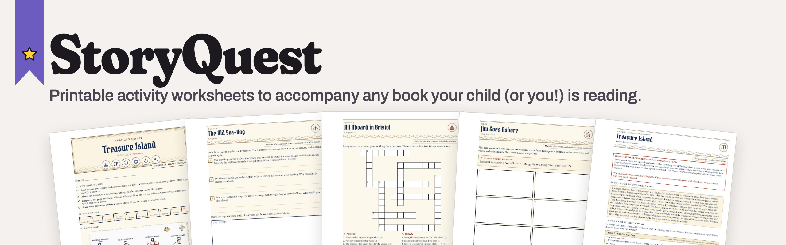
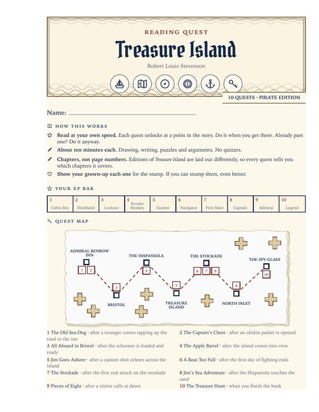
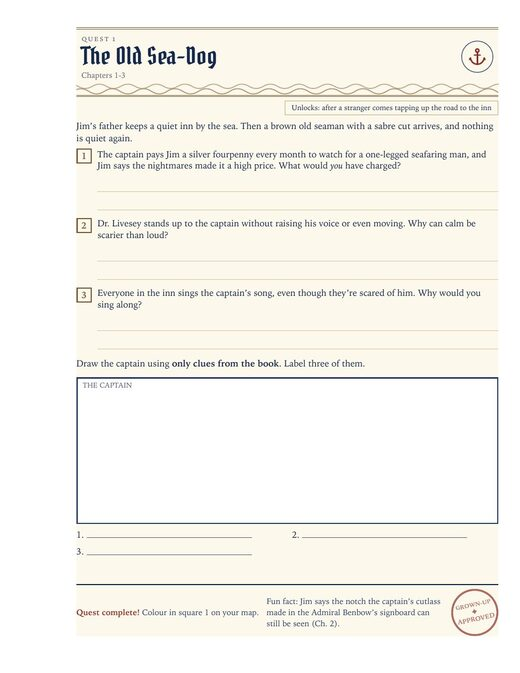
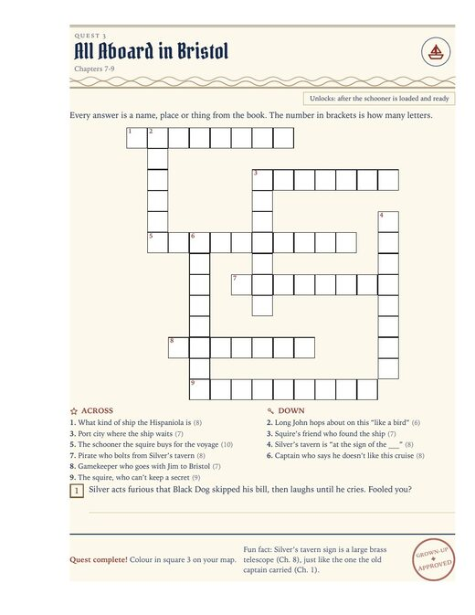
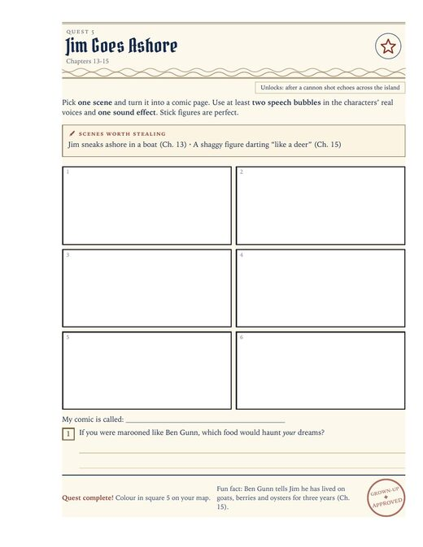
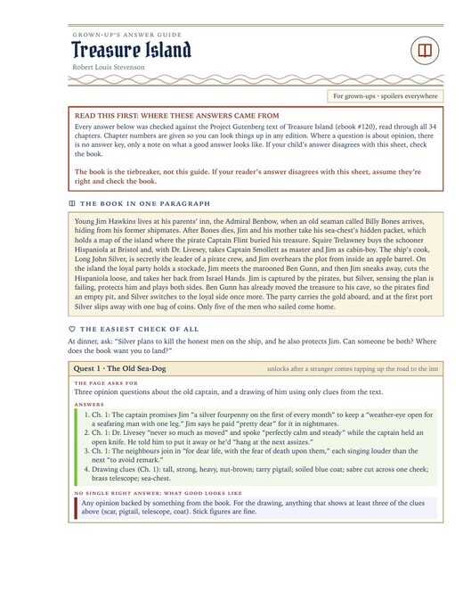
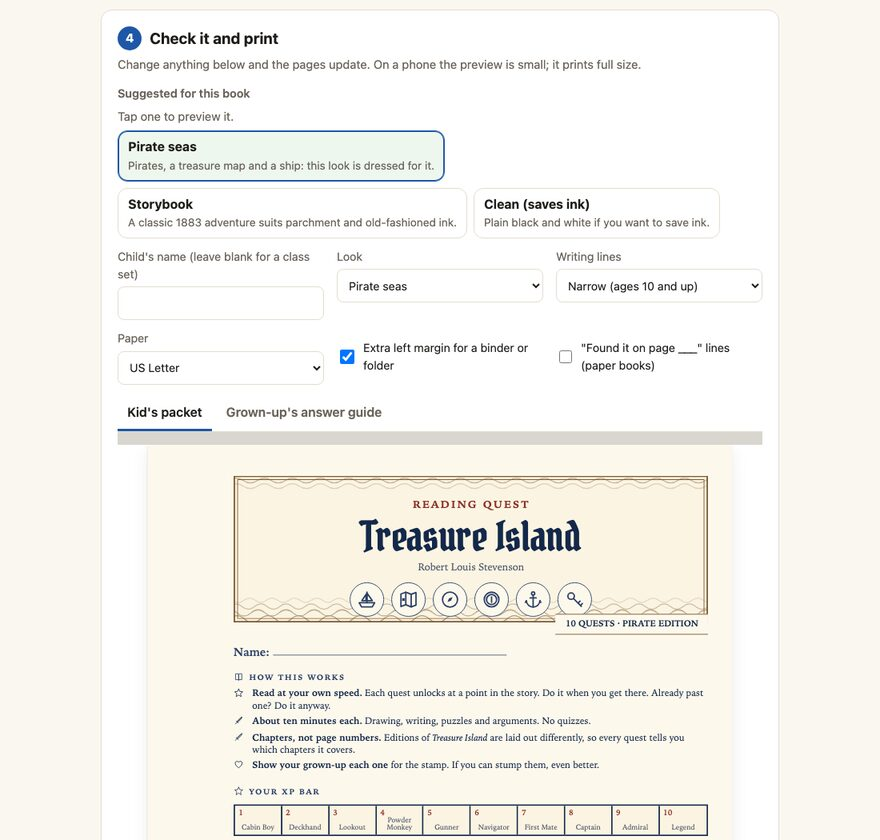

<p align="center">
  
</p>

<p align="center">
  <a href="https://github.com/Fletchwork/storyquest/actions/workflows/ci.yml"></a>
  <a href="LICENSE"></a>
  
</p>

# StoryQuest

**Printable activity worksheets to accompany any book your child (or you!) is reading.**

As a techy dad trying to motivate my kids to read more, I asked myself: can AI help? StoryQuest was born from a simple idea: add fun activities that encourage reading while fostering comprehension and imagination.

StoryQuest helps parents and teachers create custom worksheets and activities for any book a child is reading. Each packet matches the book's theme, whether it's pirates for Treasure Island or a space adventure for a sci-fi story. You use your preferred AI tool to gather details about the story and generate an activity booklet. The result is a print-friendly PDF, including an answer guide for adults. Since AI can make mistakes, I recommend reviewing the packet before giving it to your child.

<p align="center"><a href="https://fletchwork.github.io/storyquest/"></a><br>
<sub>Hosted on GitHub Pages: <a href="https://fletchwork.github.io/storyquest/">fletchwork.github.io/storyquest</a></sub></p>

Each packet includes a cover with a progress bar and quest map, followed by one page per activity. Activities range from drawing and comics to crosswords, creative writing, debates, and invention challenges. Each page is unlocked as the child reads, with no deadlines. StoryQuest works for a single child or an entire class.

StoryQuest is free to use, and your information stays on your device.

## Example packet

<p align="center">
  
  
  
  
  
</p>

<p align="center"><sub>A cover · a quest · a crossword · a comic · the answer guide</sub></p>

<p align="center"><b>Download the Treasure Island sample:</b> <a href="docs/samples/treasure-island-packet.pdf">kid's packet (PDF)</a> · <a href="docs/samples/treasure-island-guide.pdf">grown-up's answer guide (PDF)</a></p>

## Make one (about 15 minutes, no installing)

1. **Open the StoryQuest page:** https://fletchwork.github.io/storyquest/
2. **Click "Copy the instructions"** and paste them into any chat AI you already use, such as ChatGPT, Claude, Gemini or Copilot.
3. **Answer the AI's questions** about the book and the child. It then writes everything as one long block of text.
4. **Copy that block** and **paste it into the StoryQuest page**.
5. **Check the pages and print.** You can change the child's name, the look and the paper size there. Choose "Save as PDF" in the print window to keep a copy. More printing help: [docs/printing.md](docs/printing.md).

<p align="center"></p>

## If you already use an AI coding tool

If you use a tool like Claude Code, Codex, Cursor or similar, you don't need to clone anything yourself. Start it in an empty folder and ask:

```text
Clone https://github.com/Fletchwork/storyquest, read its AGENTS.md, and help me make a reading packet.
```

The agent follows [AGENTS.md](AGENTS.md). It asks who the packet is for and which book they're reading, researches the book, writes the pack and builds the PDFs. Once the repo is on your computer, `/make-packet` in Claude Code does the same.

```bash
python3 cli/storyquest.py build my-book.storyquest.json   # needs Chrome, Chromium or Edge
```

- The pack format is in [docs/pack-format.md](docs/pack-format.md).
- [docs/teaching-notes.md](docs/teaching-notes.md) explains why the pages are built the way they are.

## Privacy

The web page runs entirely in your browser. Nothing you paste is uploaded. There are no accounts and no analytics. Your last packet is saved on your own device so you can come back to it, and "Start a new packet" forgets it.

## Credits and license

MIT licensed. The fonts are under the SIL Open Font License, except Special Elite (Apache 2.0); the licenses are in `engine/fonts/`. The Treasure Island example uses Robert Louis Stevenson's public-domain novel, checked against the [Project Gutenberg](https://www.gutenberg.org/ebooks/120) text. Made by [Fletchwork](https://fletchwork.com).

